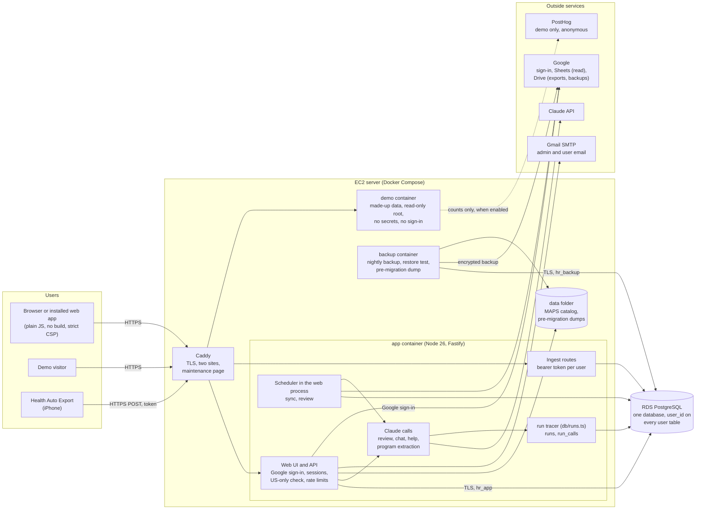

# Architecture as it runs today (v3 Phase 1H)

This is the system since the cutover on 2026-11-17: one EC2 server and RDS PostgreSQL in the owner's AWS account, every
key the owner's ([target.md](target.md) shows the network and keys; [ADR 0009](../adr/0009-infrastructure.md) and
[ADR 0010](../adr/0010-postgres-operations.md) say why). The planned changes are in `docs/adr`. No addresses, account
details or hostnames appear here; Parameter Store holds them.

## Components
- **Web and API** (`server/app.js`, 112 routes):
  - Google sign-in and sessions.
  - Users who are pending, rejected or without consent are sent to their own pages.
  - The US-only check uses a local location database (DB-IP Lite), which also feeds the admin's usage totals. Nothing is looked up outside.
- **Ingest** (`/api/ingest/*`): Health Auto Export posts with each user's own token. It is open without a session and has its own rate limits.
- **Scheduler** (`server/scheduler.js`): it runs inside the web process, on the owner's time zone.
  - It runs sync and the review for each approved user. The backup and restore test show on its schedule but run in the backup container.
  - In-memory sets keep sync, review and chat to one at a time per user. A 30-minute stale check on `runs` stops a job overlapping itself.
  - Failures email the admin (`server/alerts.js`).
- **AI:** each Claude call happens in the request or job that needs it, on that user's AI access (their own key, or the owner's with a monthly cap).
  - The run tracer (`db/runs.ts`) records metadata, tokens and cost in `runs` and `run_calls`. The monthly caps are computed from those.
  - Prompts and replies are never logged.
- **Data:** one RDS PostgreSQL database, private, TLS only with the certificate verified, 7 days of point-in-time recovery.
  - Every user table carries `user_id`. Every query binds it through `db/scope.ts`, checked by a static guard and a route-by-route isolation test.
  - Three roles: `hr_app` (rows only, no DDL), `hr_migrate` (owns the schema; migrations run as it, from the backup container), `hr_backup` (read only).
  - Migrations are append-only, and before any of them runs a `pg_dump` is taken and proven in a scratch cluster.
  - The same code still runs on SQLite (this PC, tests and the 14-day rollback path); `test/cross-engine.test.js` keeps the two answering byte for byte alike.
- **Settings:** Parameter Store, encrypted with the owner's key; `deploy/env-from-ssm.sh` writes the containers' env files before every start.
- **Backups:** the backup container takes a nightly `pg_dump` as `hr_backup`, proves it by restoring into a throwaway local cluster, then gzips and encrypts it with a passphrase-derived key before it leaves the server for Google Drive. A monthly restore test decrypts the newest one into a temporary folder, restores it there and compares row counts.
- **Demo:** the same image in a separate container, with no env file, a read-only root, an empty tmpfs data folder and a made-up database rebuilt each day. It cannot reach the app's data or secrets.

## Trust boundaries
1. **The internet to Caddy:** TLS only. The demo is a separate site.
2. **Caddy to the app:**
   - every route except health and ingest needs a Google session for an approved account, from an allowed country;
   - writes must be same-origin;
   - every route has a per-address ceiling.
3. **Ingest:** a per-user bearer token (only its hash is stored), JSON only, 5 MB, rate limited.
4. **The app to outside services:**
   - only computed summaries and the owner's own notes go to Claude;
   - Google Sheets is read-only;
   - only the app's own files go to Drive, and backups are encrypted first;
   - email carries names, dates and links only.
5. **The demo:** made-up data, no secrets, every write refused. Anonymous counts go to PostHog only when enabled, and never with Global Privacy Control on.
6. **The app to the database (row-level security, ADR 0011):** each statement runs as its user, so the database returns only that user's rows even if a query forgets its filter. The admin screens, backups and transfer tools read every user's rows in an explicit all-users mode. This guards against mistakes in code, not against a compromised server.

## Known limits that v3 addresses
- The old Lightsail server, stopped, and its snapshots keep AWS-managed keys until they are deleted on 2026-12-01; then the exception (ADR 0003) ends.
- Row-level security in the database (Phase 1I) is next; today isolation is enforced in code.
- Background jobs share the web process (ADR 0002, ADR 0004).
- Ingest, jobs and AI calls share one process and its secrets (ADR 0002).
