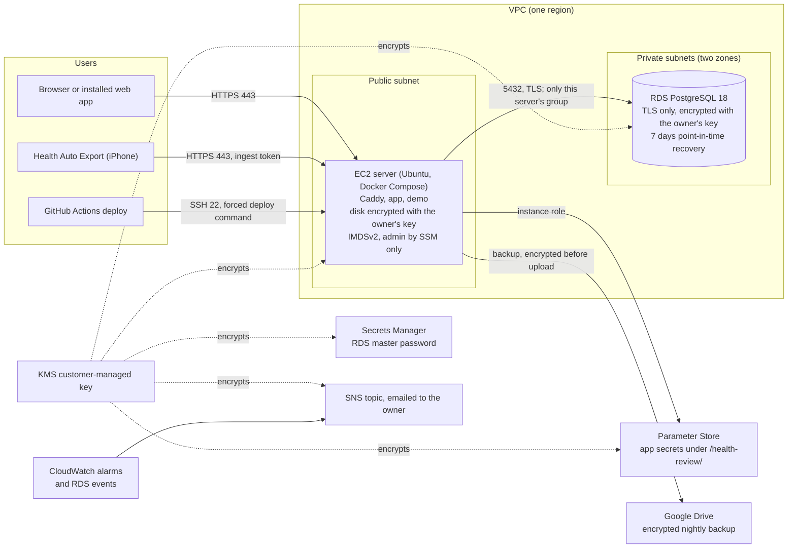

# Where production is moving (v3 Phase 1, written 2026-11-13)

This is the target after the cutover (Phase 1H), from the Terraform in `infra/` ([ADR 0009](../adr/0009-infrastructure.md)).
Until then, production runs as in [current.md](current.md). The containers don't change: the app, the demo and Caddy move
to the new server as they are, and only the database moves out of the app's data folder. No addresses or account details
appear here.

## Trust boundaries that change
- **The database leaves the server.** It's reachable only from the server's security group, over TLS, and never from the internet.
- **Every key that protects health data is the owner's:** the database, its backups and snapshots, the server's disk and the secrets. This ends the Lightsail exception.
- **Secrets move from the server's `.env` file to Parameter Store.** The server reads them with its instance role, and no AWS key exists on any machine.
- **Administration is through SSM Session Manager.** The only SSH key on the server is the deploy key, which can only run the deploy script.
